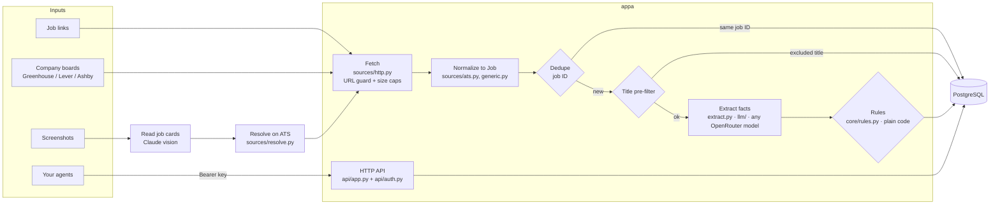
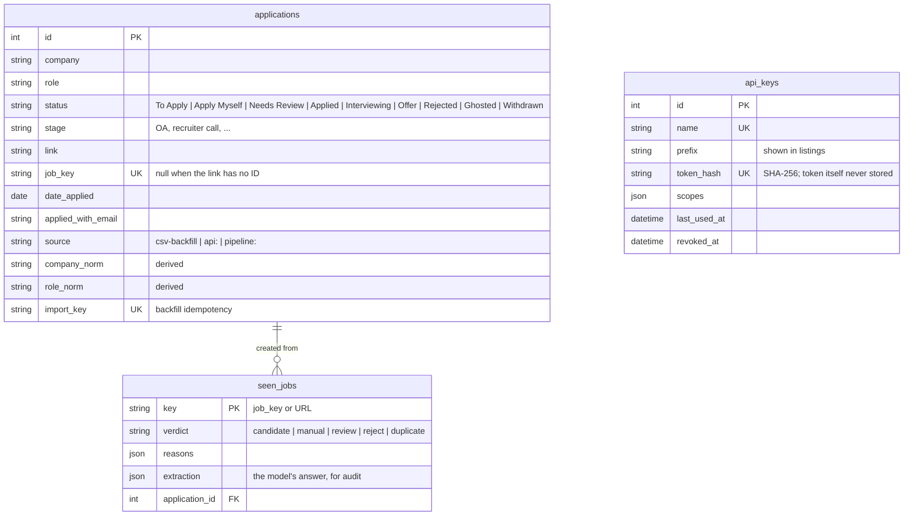
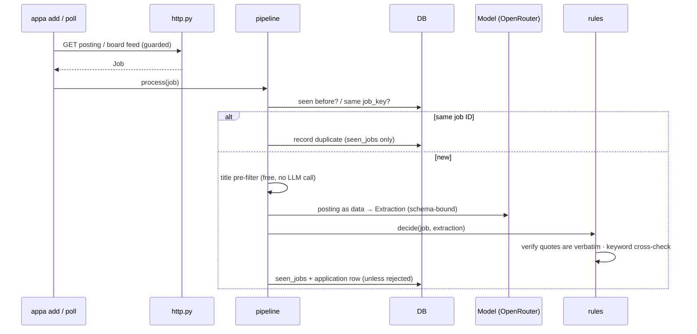

# Architecture

New here? Start with the guided [TOUR.md](TOUR.md); this page is the reference.

appa is a single-user job-search pipeline with an application database and an
authenticated API. It finds, screens and surfaces matches for you to review; you apply. It can
prefill a form in your browser, but it never submits one. This document describes **what exists
today**. Plans are in [ROADMAP.md](ROADMAP.md); threats and controls are in [SECURITY.md](SECURITY.md).

About 1,900 lines of Python, in one package, run from one machine.

## The big picture

Two ideas shape everything:

1. **The model reads and code decides.** Claude only fills a fixed schema of facts
   (sponsorship stance, citizenship/clearance, years, seniority), each with a
   verbatim quote. `rules.py` makes every accept/reject decision, and it only
   rejects on evidence it can find word for word in the posting.
2. **The job ID is identity.** A posting is the same job only if its link's job
   ID matches. A duplicate application beats a missed one, so nothing else
   blocks: not company, not title, not rows without IDs.

## Modules

| Module | Responsibility | Talks to |
|---|---|---|
| `cli.py` | Entry point (`appa add/screenshot/poll/list/backfill/export/keys/serve`) | everything |
| `pipeline.py` | One job in, one verdict out: dedupe, then pre-filter, extract, rules, routing hook, record | db, extract, rules |
| `agents/` | Roles: `scout` (find + screen), `screener` (screen + profile.md routing), `concierge` (questions). A `RoleSpec` = input schema + run function + default budget | runtime, pipeline, sources |
| `runtime/runs.py` | Create, execute, cancel, follow runs; `stop_all` kill switch | db, agents |
| `runtime/context.py` | `RunContext`: every tool call, model call and question goes through it; records `run_events`; enforces budgets, cancel, pause, daily cap | db |
| `runtime/queue.py` | Postgres job queue: `FOR UPDATE SKIP LOCKED` claims, leases, backoff retries, `NOTIFY` wake-ups | db |
| `runtime/worker.py` | Claims and executes runs; lease heartbeat; never crashes on a role error | runtime |
| `runtime/scheduler.py` | Cron schedules (UTC) → queued runs | runtime |
| `runtime/render.py` | Run events → readable lines for the CLI | — |
| `extract.py` | Prompts: posting → `Extraction`; screenshot → job cards. Structured output only | llm |
| `llm/` | Model layer: allowlist + per-role defaults (`config/models.yaml`), OpenRouter adapter, strict JSON schema, validation + one corrective retry, cost and token accounting | OpenRouter |
| `evals.py` | Screening eval: labeled cases → per-field and verdict accuracy, false rejects, cost | extract, rules |
| `core/rules.py` | Deterministic verdicts, quote verification, keyword cross-checks | — |
| `core/models.py` | `Job` (normalized posting), `Extraction` (LLM output schema), `Decision`/`Verdict` | — |
| `core/jobid.py` | Job ID from any link format → `job_key` like `greenhouse:123` | — |
| `core/ats_urls.py` | Recognize Greenhouse/Lever/Ashby links (slug + job ID) | — |
| `core/normalize.py` | Canonical company / title / date forms | — |
| `db.py` | SQLAlchemy models, engine (pool limits, timeouts), `find_match` (dedupe) | PostgreSQL |
| `migrate.py` + `migrations/` | Alembic schema migrations, run as the owner role | PostgreSQL |
| `api/app.py` | FastAPI app under `/api/v1`: routers, per-route body limits, security headers, error handlers | routes |
| `api/deps.py` | Who's calling: browser session (+CSRF on writes) or scoped API key; rate limits | users, auth |
| `api/users.py` | Human login: argon2id, optional TOTP, lockout, session tokens (hashed), CSRF tokens | db |
| `api/auth.py` | API key creation/verification (hashed), rate limiter | db |
| `api/routes/` | `auth`, `applications` (list takes several `status` params; detail includes `screening` and `prefill`), `runs` (incl. SSE stream), `questions`, `schedules`, `profile` (profile.md + policy), `uploads`, `system` (incl. `GET /system/overview`), `meta` | runtime, db |
| `core/apply_fields.py` | Form questions: standard answer keys, must-ask rules (bot/AI checks, essays), option matching that never guesses | — |
| `apply/planner.py` | Form questions + answers bank → fill plan, or the questions only you can answer. Values come only from your bank | core |
| `apply/service.py` | Prefill attempts end to end: start, claim, plan (or ask you), preview → `ready`, `mark_applied` when you say you submitted it. Statuses: preparing → needs_you → ready → applied (or failed / cancelled). No submit step exists | db, queue |
| `api/routes/runner.py` | Runner-only endpoints (`runner` scope): next job, heartbeat, done/fail, events, form, screenshot, preview, blocked | apply |
| `api/routes/apply.py` | Start a prefill, mark applied (`POST /applications/{id}/applied`), take over, attempts (redo/cancel), answers bank, screenshot viewing | apply |
| `runner/` | On your Mac: `client.py` (HTTPS to the server), `browser.py` (dedicated Chrome profile, navigation pinned, pop-ups closed, `hand_over()` gives the filled tab to you), `dom.py` (find the form, read it, fill it; never submits), `main.py` (loop; prepare is the only phase) | Playwright |
| `uploads.py` | Screenshot validation from content, re-encode to PNG, private storage | Pillow, db |
| `profile_store.py` | Versioned `profile.md` and policy in the DB, falling back to the config files | db |
| `backfill.py` | Idempotent CSV import from your old spreadsheet | db |
| `sources/http.py` | **All** outbound HTTP: scheme/port/host checks, private-IP block on every redirect hop, size caps | the internet |
| `sources/ats.py` | Greenhouse, Lever and Ashby public JSON feeds → `Job` | http |
| `sources/generic.py` | Other careers pages; finds an embedded ATS or falls back to page text | http, ats |
| `sources/resolve.py` | Company + title (from a screenshot) → the real posting on its ATS | ats |
| `sources/text.py` | HTML → text; pulls hidden text out and labels it | — |
| `config.py` | Loads `config/profile.yaml` (your rules, gitignored) | — |

**Web app (`web/`):** a React + TypeScript single-page app. `App.tsx` is the shell (sidebar, hash
routing, login gate). Pages: `Matches.tsx` (home: the review queue with tabs *Good matches*, *Check
first* and *Apply directly*, the **Needs you** cards, a detail drawer with checks and quotes, and the
actions Open posting / I applied / Prefill in my browser / Not for me), `Applied.tsx` (tracker),
`Discover.tsx` (listings inbox), `Sources.tsx` (sources, schedule, Search now), `Activity.tsx` (runs
and logs) and `Settings.tsx` (filters, preferences, saved answers). `ui.tsx` holds shared components,
`hooks.ts` `useData` and `useToast`, `format.ts` formatting helpers (unit-tested). `api.ts` is the only
code that calls the server (relative `/api/v1` URLs, CSRF header on writes); `types.ts` mirrors its
shapes. `styles.css` is the light/dark design system.

Dependencies point one way: `cli → runtime → agents → pipeline → (extract, llm, db, sources) → core`.
`core/` is pure logic and imports nothing that does I/O. Nothing in `sources/` knows about the database.

## Data model

- **`applications`** is the source of truth: everything you applied to, plus jobs
  the pipeline found (`To Apply`, `Apply Myself`, `Needs Review`).
- **`seen_jobs`** logs every posting the pipeline evaluated, including rejects, so
  polling never re-pays for the same posting and every verdict can be audited.
- Derived columns (`*_norm`, `job_key`) are recomputed on every insert or update
  by an ORM event, so they can't drift from the raw values.

## Key flows

### A posting through the pipeline

Ordering is deliberate. The free checks (seen, job ID, title) run before the only
paid step, the model call.

### An agent records an application

1. `GET /v1/applications/check?company=&link=`: `already_applied: true` only on the same job ID.
2. The agent applies.
3. `POST /v1/applications`: 201, or 409 with the existing row if the job ID is already tracked.
4. Later: `PATCH /v1/applications/{id}` for status or stage changes.

### A form gets prefilled (you submit it)

1. You press **Prefill in my browser** (`POST /api/v1/applications/{id}/apply`, or `appa apply <id>`). An attempt starts as `preparing` and a `prepare` job is queued.
2. The runner on your Mac claims it, opens the form in the dedicated Chrome window and sends the questions it found.
3. The planner fills what your saved answers cover. Anything else becomes a **Needs you** card and the attempt waits as `needs_you`; your answer is saved and the attempt goes back to `preparing`.
4. The runner fills the form, sends a screenshot and fill report, and hands the tab over (`browser.hand_over`: the navigation guard and pop-up blocking are lifted for that tab, and appa never closes it). The attempt is `ready` and an `apply_ready` card says so.
5. You check the form and press submit yourself. Then you mark it applied: the card's **I submitted it** (`applied`), `POST /api/v1/applications/{id}/applied`, or `appa applied <id>`. Only then is the application `Applied`. **Skip** cancels the attempt.

There is no submit phase, submit endpoint or submit code; `tests/test_apply.py::test_appa_never_submits`
fails if one appears. Login walls, wizards and bot-protection pages are handed back before anything is
filled.

## Runtime and deployment (today)

| Piece | Where it runs |
|---|---|
| CLI | Your Mac. `add`/`screenshot`/`poll` run inline by default; `appa run` queues for a worker. |
| Worker(s), scheduler | `appa worker` (any number) and `appa scheduler` (one), long-running processes |
| API | `appa serve` → `127.0.0.1:8787`. It refuses any non-loopback bind unless `APPA_BEHIND_PROXY=1`. |
| Database | PostgreSQL 17. Locally: `scripts/dev-db.sh` runs a cluster in `data/pg` on `127.0.0.1:5433`. The app connects as `appa_app` (`APPA_DATABASE_URL`); migrations run as `appa_owner` (`APPA_MIGRATIONS_DATABASE_URL`). |
| LLM | OpenRouter, any model in `config/models.yaml` (default screener: `anthropic/claude-haiku-5.5`). Picked per run with `--model`. |
| Secrets | `OPENROUTER_API_KEY` and database URLs from the environment (`.env` locally, gitignored, mode 600). Agent keys live hashed in the DB. |

## Known design debts

These are all deliberate for v0, and all have a seam ready:

- **Single tenant.** There's no user or tenant concept. The hosted tier needs a `tenant_id` on every row and row-level security (see ROADMAP).
- **In-process rate limiter.** It's correct for one server process and resets on restart. Multiple workers need a shared store such as Redis.
- **Postings are screened one at a time inside a run.** Runs are queued and spread across workers, but within one Scout run postings go through sequentially. Batching (e.g. the Batch API) is the path to cheaper bulk screening.
- **No lockfile.** Dependencies have lower bounds only. Pin them for reproducible builds.
