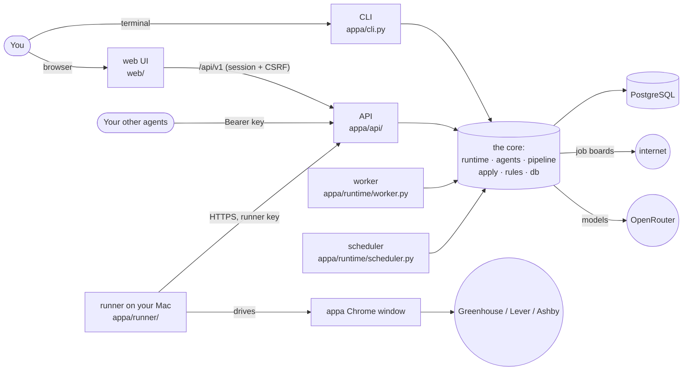
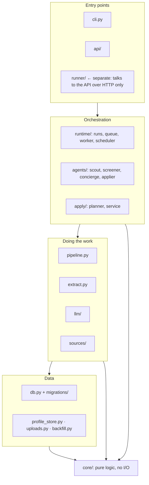
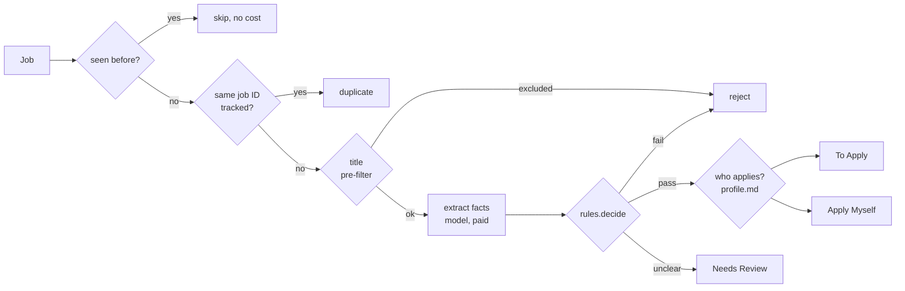
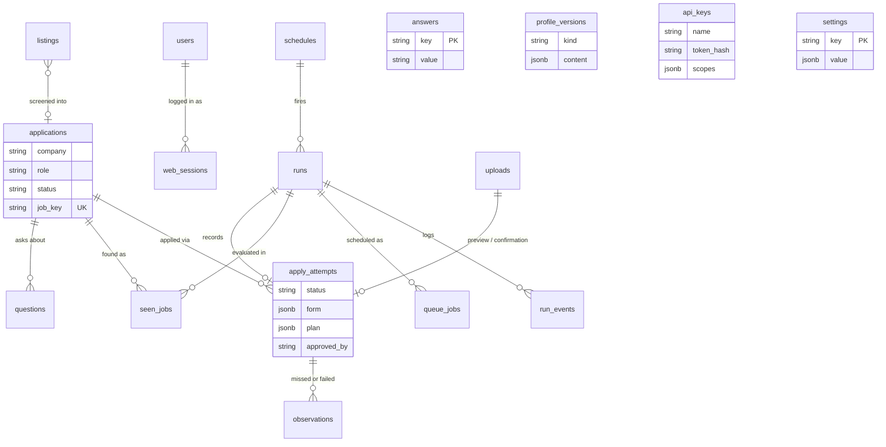
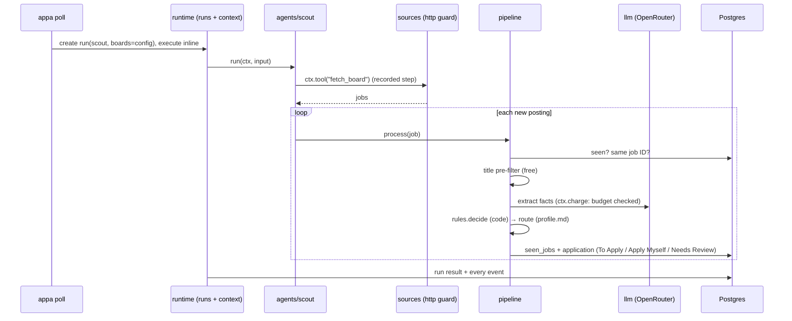
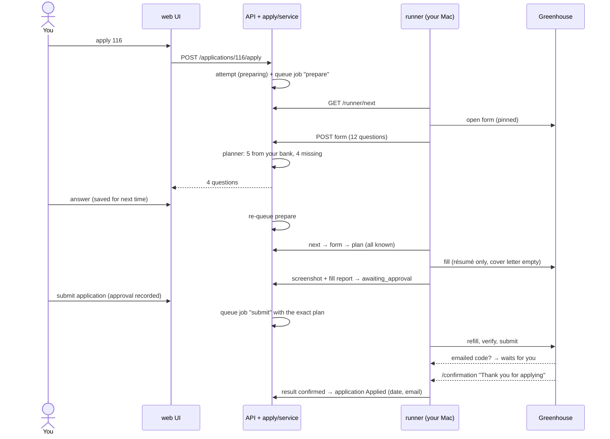
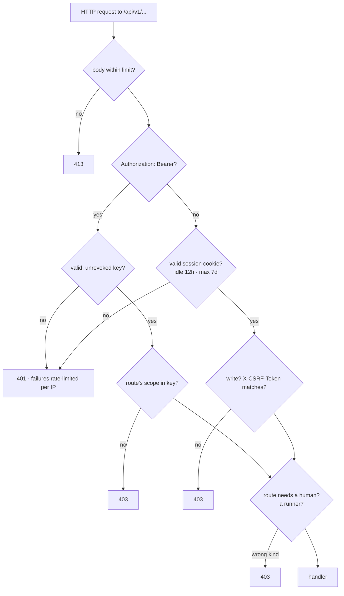

# A guided tour of the appa codebase

Read this with the code open. It explains what every group of files is for, how they connect,
and how a job moves through the system. [ARCHITECTURE.md](ARCHITECTURE.md) is the reference,
[SECURITY.md](SECURITY.md) the threat model, and [DESIGN-v1.md](DESIGN-v1.md) the plan.

Size, for orientation: about 4,700 lines of Python in `appa/`, 1,000 of TypeScript in `web/`,
and 1,800 of tests. No single file is over about 600 lines.

---

## 1. The 30-second version

appa is **one server** (API + workers + scheduler, sharing one Postgres) plus **one runner on your
Mac** that drives a dedicated Chrome. You talk to it through a terminal-style web page or the CLI.



Three ideas run through everything:

1. **The model reads and code decides.** Models only extract facts or pick among your existing answers. Every accept/reject/apply decision is plain code you can read and test.
2. **The job ID is identity.** Only a matching job ID blocks a job. A duplicate application beats a missed one.
3. **Nothing irreversible happens without you.** Submitting needs your recorded approval. Essays, "are you human" checks, CAPTCHAs, verification codes and ambiguous questions come to you.

---

## 2. Where everything lives

```
appa/                  the Python package (server, CLI, runner)
  core/                pure logic: rules, job IDs, form-question matching. No I/O at all
  sources/             the internet coming in: guarded HTTP, job boards, careers pages, screenshot resolve
  llm/                 model layer: OpenRouter adapter, allowlist, schema validation, cost
  extract.py           the prompts: posting -> facts, screenshot -> job cards
  pipeline.py          one posting -> one verdict (dedupe, filter, extract, rules, route, record)
  agents/              roles you can run: scout, screener, concierge (+ applier, internal)
  runtime/             runs, events, budgets, the Postgres job queue, worker, scheduler
  apply/               applying, server side: planner (what goes in each field) + service (lifecycle)
  runner/              applying, your Mac: browser, form reader/filler, HTTP client, loop
  api/                 FastAPI: auth (sessions, keys), routes for everything above
  db.py                every table (SQLAlchemy models) + the dedupe query
  profile_store.py     your profile.md + policy, versioned in the DB
  uploads.py           screenshot validation and private storage
  backfill.py          one-time import of your old spreadsheet
  evals.py             score models on labeled postings
  config.py, migrate.py, cli.py
web/                   the terminal-style UI (React + TypeScript)
migrations/            Alembic schema migrations (0001 … 0004)
config/                example configs (committed) + your real ones (gitignored)
deploy/postgres/       least-privilege database roles
scripts/dev-db.sh      local Postgres in data/pg
evals/screening/       16 synthetic labeled postings
tests/                 181 tests (Postgres-backed + real headless Chrome)
docs/                  this tour, architecture, security, design, roadmap
```

What's **yours and gitignored:** `.env` (secrets), `config/profile.yaml`, `config/profile.md`,
`config/answers.yaml`, `data/` (Postgres, uploads), `evals/local/`, `evals/results/`.

---

## 3. Layers and the dependency rule

Imports only point downward. Lower layers never know about the ones above them.



Two boundaries are worth knowing:
- **`core/` does no I/O.** You can unit-test every rule in it without a database or network.
- **`runner/` imports nothing from the server.** It's a client that only speaks HTTP, so the code running in your browser session can't reach your database, answers bank or model keys.

---

## 4. The groups, one by one

Each group lists its job, its files in reading order, and the rules it must never break.

### 4.1 `core/`: the rules, with no I/O

| File | What's in it |
|---|---|
| `models.py` | `Job` (a normalized posting), `Extraction` (the facts a model returns: sponsorship stance, citizenship, clearance, years, seniority, suspicious text, each with a quote), `Decision` / `Verdict` |
| `rules.py` | `decide()`: the hard rules. Rejects **only on quotes found verbatim in the posting**, and cross-checks keywords so a manipulated model can't wave a restricted job through. `title_rejects()` is the free pre-filter |
| `jobid.py` | The posting's identity, for **any** site. `job_key(url)` reads IDs from link formats (Greenhouse, Lever, Ashby, `gh_jid`, Workday `_JR-123`, Microsoft `pid`, Amazon, LinkedIn …). `resolve_key(link, job_id, company)` falls back to an ID found another way, scoped to the site (or company). `verified()` accepts an AI-read ID only if it's on the page word for word. `ids_in_text()` reads IDs from your notes |
| `ats_urls.py` | Recognizes Greenhouse/Lever/Ashby links: board slug + job ID |
| `normalize.py` | Canonical company/title/date forms for matching |
| `apply_fields.py` | Application-form questions: `FormQuestion`, which **standard answer** a question means (`standard_key`), which must come to you (`must_ask`: essays, bot/AI checks, puzzles), and `match_option`, which maps your answer onto a dropdown and **never guesses** |

**How a posting gets its ID:** a recognized link pattern, then the page's own structured data, then (with a key) an AI read that must appear verbatim on the page, then an ID you or your agent pass in (`job_id` on `POST /applications`, `appa track --job-id`), and finally IDs in your notes (`appa ids`). An ID already owned by another row is never reused, and the same company + ID on two sites counts as the same posting.

**Invariants:** a reject needs verbatim evidence. A question touching two standard answers ("authorized… *without* sponsorship") maps to none and comes to you. An unidentified file field gets nothing.

### 4.2 `sources/`: the internet coming in

| File | What's in it |
|---|---|
| `http.py` | **The only way appa makes outbound requests.** Every request and every redirect hop is checked: http(s) only, ports 80/443, public IPs only (no localhost, private ranges or cloud metadata). Size caps; LinkedIn never fetched |
| `ats.py` | Greenhouse, Lever and Ashby public JSON feeds → `Job` |
| `generic.py` | Other careers pages: finds an embedded ATS, or falls back to page text |
| `fetch.py` | `fetch_posting(url)`: picks `ats` or `generic` |
| `page_ids.py` | The page's own job ID: JSON-LD `JobPosting.identifier`, canonical link, job-ID meta/attributes |
| `resolve.py` | Company + title (from a screenshot) → the real posting on its board |
| `text.py` | HTML → text. **Hidden text is pulled out and labeled `[HIDDEN-ON-PAGE]`** so the model reports it instead of obeying it |

### 4.3 `llm/` + `extract.py`: models

| File | What's in it |
|---|---|
| `llm/registry.py` | Reads `config/models.yaml`: the **allowlist** (only listed models can run), the default per job, routing preferences. `complete(role, messages, schema=…, model=…)` is the one entry point |
| `llm/openrouter.py` | The adapter: strict JSON-schema output, **validated again in our code**, one corrective retry, real cost from OpenRouter's usage report, typed errors |
| `llm/base.py` | `Completion` (text, parsed output, tokens, cost) and the error types |
| `llm/schema.py` | Makes a Pydantic model's schema strict-mode-compatible |
| `extract.py` | The prompts. `extract_with_meta(job)` → `Extraction` + cost. `read_screenshot()` → job cards. Errors are split into **fatal** (no key, provider down: stop the run) and per-posting (send to review) |

Nothing here runs today, because there's no key. Applying never needs it.

### 4.4 `pipeline.py` + `agents/`: deciding about postings

`pipeline.Pipeline.process(job)` is the heart of screening. Its steps are ordered so **free checks run before paid ones:**



| File | What's in it |
|---|---|
| `agents/base.py` | `RoleSpec`: input schema + run function + default budget + flags (`startable`, `uses_models`) |
| `agents/scout.py` | Finds postings (links, screenshots, boards) and screens each |
| `agents/screener.py` | Screens links. Also the **"who applies" router**: it reads your `profile.md` and sees **only company, title and location, never posting text**, so it can't be prompt-injected. Your override lists win over it |
| `agents/concierge.py` | Turns review items into questions for you. No model calls |
| `agents/applier.py` | Placeholder role for apply runs. Not startable directly; the apply service creates these runs |

### 4.5 `runtime/`: runs, budgets, the queue

Everything appa does is a **run**: one role, one model, one budget, and an append-only log of
events (`run_events`). The terminal and the UI both just display that log.

| File | What's in it |
|---|---|
| `runs.py` | `create()` (validates input and model), `execute()` (runs a role, never crashes the caller), `cancel()`, `stop_all()` (kill switch), `follow()` |
| `context.py` | `RunContext`: what a role uses for everything. `tool()` records each step, `charge()` each model call, `ask()` leaves you a question, and `check()` enforces **budget, cancel, pause and the daily cap** |
| `queue.py` | The job queue, in Postgres: `claim()` uses `FOR UPDATE SKIP LOCKED` (each job goes to exactly one worker), leases expire if a worker dies, failed jobs back off and retry |
| `worker.py` | Claims `run` jobs and executes them; heartbeats its lease; `LISTEN`s for instant wake-ups |
| `scheduler.py` | Cron (UTC) → queued runs. Skips missed slots instead of piling up |
| `render.py` | Events → terminal lines (`web/src/render.ts` mirrors it) |

### 4.6 `apply/` + `runner/`: applying

Split by design: **the server decides, the runner only does.**

| Server side | |
|---|---|
| `apply/planner.py` | `build_plan(questions, answers)`: for each form question, uses your saved answer to that exact question, then the must-ask rules, then your standard answer, then (with a key) a model that may only *choose* one of your existing answers. What's left and required becomes a question for you |
| `apply/service.py` | The attempt lifecycle: `start` → `claim` → `receive_form` (plan, or stop and ask) → `receive_preview` → `approve` (**the only place a submit job is created**; daily cap) → `receive_result` (**"Applied" only with a confirmation page**). Also `redo`, `cancel`, `answer_field` |

| Runner side (your Mac) | |
|---|---|
| `runner/main.py` | The loop: poll `/runner/next`, run **prepare** (read, fill, screenshot) or **submit** (refill, verify, submit, confirm), heartbeat, retry if the server is down. Waits for you on CAPTCHAs and emailed verification codes |
| `runner/dom.py` | `find_form()` gets to the form on any site (follows "Apply", opens embedded forms) or raises `Blocked` (login wall, wizard, bot protection, off-site). `EXTRACT_JS` reads fields (tuned for Greenhouse/Lever/Ashby, plus common form layouts). `fill()`, `submit()`, `confirmation()`, CAPTCHA and verification-code detection |
| `runner/browser.py` | Dedicated Chrome profile. **Refuses private or local addresses.** Navigation pinned to the application's own site (domain + subdomains) and hosted ATS domains; pop-ups closed; downloads refused |
| `runner/client.py` | HTTPS only (HTTP only to localhost), runner-scoped key |

### 4.7 `db.py` + `migrations/` + stores: data

`db.py` holds all 18 tables and `find_match()` (the dedupe query). The schema only changes
through migrations, which run as the owner role; the app connects as a role that can't alter the schema.



| File | What's in it |
|---|---|
| `db.py` | Tables, engine (pool limits, timeouts, UTC sessions), `find_match()` |
| `migrations/versions/0001…0007` | Initial schema → runtime → people (users, sessions, uploads, profile history) → apply → job IDs → observations → feeds (listings inbox, boards) |
| `feeds/` | Every job source: `lists/` (many companies per call), `boards/` (one company's ATS), `store.py` (the listings inbox and board rotation), `filter.py` (free filters). See docs/JOB-SOURCES.md |
| `observe.py` | Records misses and failures (`observations`); `appa insights` ranks them so you know what to fix next |
| `profile_store.py` | Your `profile.md` and policy, versioned. The newest saved version wins; the files are the fallback |
| `uploads.py` | Image validation from the bytes, re-encoded to PNG (drops metadata), stored with owner-only permissions |
| `backfill.py` | One-time, re-runnable import of your CSV tracker |

### 4.8 `api/` + `web/`: talking to it

| File | What's in it |
|---|---|
| `api/app.py` | The app under `/api/v1`: per-route body limits, security headers, error handlers that never leak internals |
| `api/deps.py` | **Who's calling:** a browser session (CSRF required on writes) or a Bearer key with scopes. `UserDep` (humans only), `RunnerDep` (runner key only), `require(scope)` |
| `api/users.py` | argon2id passwords, optional TOTP, lockout, session tokens (only hashes stored) |
| `api/auth.py` | API keys (only hashes stored), the rate limiter |
| `api/routes/*` | `auth`, `applications`, `runs` (+ SSE stream), `questions`, `schedules`, `profile`, `uploads`, `apply`, `runner`, `system`, `meta` |
| `web/src/api.ts` | The only code in the UI that talks to the server: relative `/api` URLs, CSRF header |
| `web/src/commands.ts` | Command-line parser (unit-tested) |
| `web/src/Console.tsx` | The terminal, live run streaming (Server-Sent Events), uploads, the profile editor |
| `web/src/Panel.tsx` | Status, your question queue (including the form-question and approval cards), runs, schedules |

---

## 5. How it all ties together: three journeys

### 5.1 A posting gets screened (`appa poll`)



### 5.2 An application gets submitted



### 5.3 A request gets authenticated



---

## 6. Where each safety rule is enforced

| Rule | Enforced in |
|---|---|
| Rejects need verbatim evidence; keyword cross-checks | `core/rules.py` |
| Hidden page text labeled, not obeyed | `sources/text.py` + `extract.py` prompt |
| No fetching internal addresses / LinkedIn | `sources/http.py` (every redirect hop) |
| Only allowlisted models; privacy-preserving routing | `llm/registry.py` + `config/models.yaml` |
| Budgets, daily cap, cancel, kill switch | `runtime/context.py`, `runtime/runs.py` |
| Only a job-ID match blocks | `db.find_match()` |
| "Who applies" can't see posting text | `agents/screener.make_router()` |
| No submit without your approval | `apply/service.approve()` (only creator of submit jobs) + `receive_result()` check |
| Values only from your bank; never guess an option | `apply/planner.py`, `core/apply_fields.match_option()` |
| Essays, bot checks, compound auth questions → you | `core/apply_fields.must_ask()` / `standard_key()` |
| Résumé only in résumé fields | `core/apply_fields.standard_key()` (file branch) |
| Never "Applied" without confirmation | `apply/service.receive_result()` |
| Browser pinned; pop-ups closed | `runner/browser.py` |
| CAPTCHA / emailed codes wait for you | `runner/main.py` |
| Sessions, CSRF, lockout, TOTP | `api/users.py`, `api/deps.py` |
| Keys scoped; runner key can't read your bank | `api/deps.py` (`RunnerDep`, `UserDep`) |
| App DB role can't alter schema | `deploy/postgres/roles.sql` |
| Uploads decoded, re-encoded, private | `uploads.py` |

---

## 7. "I want to change …" → where to look

| You want to… | Look at |
|---|---|
| Change a hard rule (years, sponsorship) | `config/profile.yaml` (values) · `core/rules.py` (logic) |
| Change who's "apply myself" | `config/profile.md` (or `profile edit` in the UI) |
| Add a model | `config/models.yaml` → run `appa eval --model …` |
| Teach it a new standard form question | `STANDARD` in `core/apply_fields.py` + a test in `tests/test_apply.py` |
| Support a new ATS's form markup | `EXTRACT_JS` / `_fill_one` in `runner/dom.py` + a fixture in `tests/test_runner_dom.py` |
| Add a job board source | `sources/ats.py` (+ `core/ats_urls.py` for its links) |
| Add an agent role | new file in `agents/` with a `RoleSpec`, register in `agents/__init__.py` |
| Add an API route | `api/routes/<area>.py`, register in `api/app.py`, pick `UserDep` / `require(scope)` / `RunnerDep` |
| Add a UI command | `web/src/commands.ts` (+ test) → handle it in `Console.tsx` |
| Change the schema | edit `db.py` → `alembic revision --autogenerate` → **read the file** → `appa migrate` |

---

## 8. Tests

| File | Covers | Needs |
|---|---|---|
| `test_core.py` | Rules, title filter, job IDs, hidden text, URL guard | — |
| `test_db_api.py` | Backfill, dedupe, application API, key scopes | Postgres |
| `test_llm.py` | Model layer + eval against a fake OpenRouter | — |
| `test_runtime.py` | Queue, budgets, cancel, kill switch, worker, scheduler, roles end to end | Postgres |
| `test_api.py` | Login, CSRF, TOTP, lockout, uploads (hostile files), runs/SSE, questions, profile | Postgres |
| `test_apply.py` | Field matching (labels from real forms), planner, the full approve-before-submit flow | Postgres |
| `test_runner_dom.py` | Reading/filling/submitting local copies of each ATS's markup; CAPTCHA, codes, pinning | headless Chrome |
| `web/src/commands.test.ts` | UI command parser | Node |

`pytest` runs everything (the database tests use `appa_test` and refuse any other database).
`npm --prefix web test` runs the UI tests.

---

## 9. Honest rough edges (worth knowing before you build on it)

- **`cli.py` is about 600 lines.** It's one function per command; worth splitting into `cli/` modules eventually.
- **`db.py` is about 400 lines.** All the tables live there; splitting by area would be cleaner.
- **The rate limiter is in-memory,** so it's per process and resets on restart. Fine for one server; use Redis if you run several.
- **The UI's live stream polls the database** every half second. `LISTEN/NOTIFY` is already wired in the worker and could replace it.
- **The Google Sheet isn't synced.** appa's database is the source of truth; your Sheet only gets updates if you export or a sync is built.
- **No lockfile yet** for Python dependencies; `web/` has `package-lock.json`.
- **Filling works on any login-free site, but multi-page wizards and sites needing accounts are handed back.** Unusual custom widgets on unfamiliar sites may not fill; the fill report and approval screenshot show it, and you decide.
- **Bot protection** (e.g. SmartRecruiters' DataDome) can block the runner. It's handed back, never evaded.
- **The model paths** (screening, routing, screenshots, fallback matching) **are tested only with a fake provider** until a key is added.
